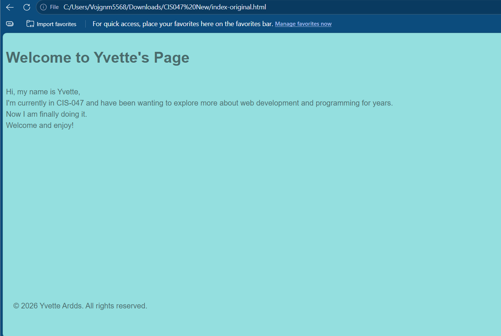
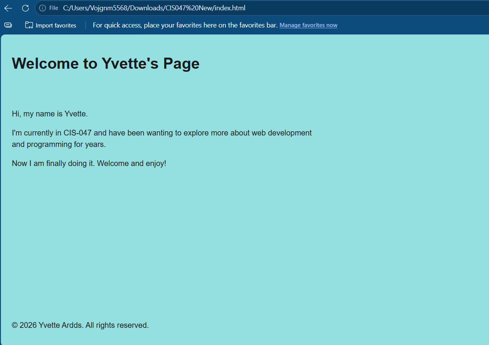
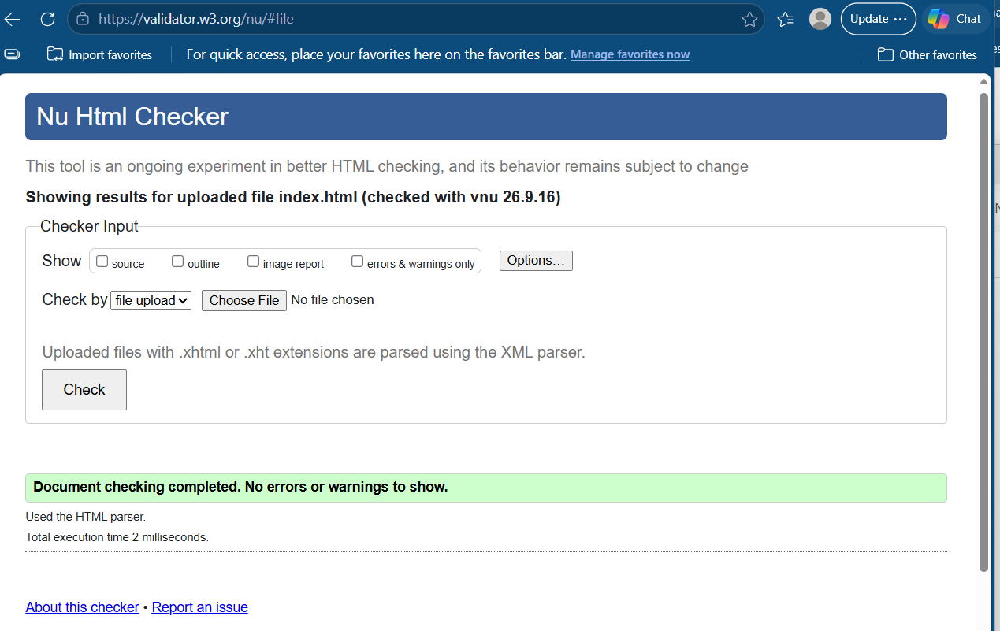
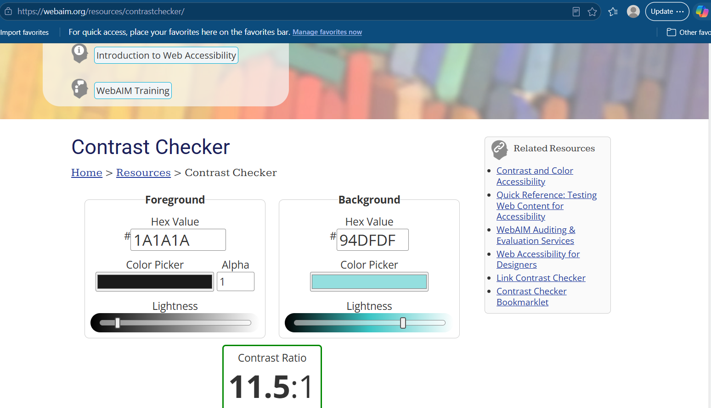

# Assignment 07 – Webpage Accessibility Enhancement

**Student:** Yvette Ardds · **Course:** CIS-047

## Files in this repository

| File | What it is |
|---|---|
| `index.html` | The revised, more accessible webpage |
| `index-original.html` | The original page, before any changes |
| `before.png` | Screenshot of the page before the changes |
| `after.png` | Screenshot of the page after the changes |
| `validator-results.png` | W3C validator result for the revised page |
| `contrast-checker.png` | WebAIM Contrast Checker result for the revised text color |

## Before and After

**Before**

**After**

## Accessibility Audit Results

| Issue or opportunity | Why it matters | Change made | Testing result |
|---|---|---|---|
| The body text used a semi-transparent gray, `rgba(17, 18, 19, 0.566)`, on a light teal background. | The text looked faded. Its contrast ratio was about 3.84:1, below the WCAG minimum of 4.5:1. People with low vision, or anyone reading in bright light, could struggle to read it. | Changed the text color to a solid dark gray, `#1a1a1a`. | Checked the colors with the WebAIM Contrast Checker. The new ratio is about 11.5:1, which passes WCAG AA and AAA for normal text. |
| The `<footer>` was placed inside a `
` element, and the page used no semantic layout elements. | This is invalid HTML. Browsers and screen readers may interpret the page structure incorrectly, and screen reader users can't jump between page regions such as the main content and the footer. | Closed the paragraphs correctly, moved the `<footer>` outside them, and wrapped the page in `<header>`, `<main>` and `<footer>`. | Validated with the W3C Markup Validator. The original had a stray `
` error; the revised page shows no errors. |
| The introduction was one paragraph broken up with ` ` tags. | ` ` creates a visual line break only. Screen readers treat the text as one block, so the separate ideas aren't identified as separate paragraphs. | Replaced the ` ` tags with separate `
` elements for each idea. | Reviewed the code and validated the page. The text now displays as properly spaced paragraphs, with no layout problems at 200% zoom. |
| The page had no viewport setting, and the title was general. | Without a viewport setting, phones may shrink the page so the text is tiny. A more specific title helps screen reader users and people with many tabs open identify the page. | Added `<meta name="viewport" content="width=device-width, initial-scale=1">` and changed the title to "Yvette Ardds – CIS-047 Web Development Student Page." | Narrowed the browser window and zoomed to 200%. The text reflowed without horizontal scrolling, and the new title appears in the browser tab. |

## Testing Summary

I validated my revised HTML using the W3C Markup Validation Service by uploading my index.html file. The original page reported an error caused by placing the footer inside a paragraph, which left a stray closing `
` tag. After I restructured the page, the validator reported no errors or warnings. I also tested with the keyboard using Tab and Shift + Tab. My page does not currently contain links or form controls, so there were no interactive elements to reach, and nothing trapped or hid the keyboard focus. I added a visible focus style so any links I add later will show a clear outline. For my additional testing method, I used the WebAIM Contrast Checker, which showed that my original text color failed with a contrast ratio of about 3.84:1 and my revised color passes at about 11.5:1. I also tested the page at 200% zoom and with a narrow browser window, and the content remained readable without horizontal scrolling. There were no reported issues that I could not correct.

## Testing Evidence

**W3C Markup Validation Service:** the revised `index.html` shows "Document checking completed. No errors or warnings to show."

**WebAIM Contrast Checker:** the revised text color `#1A1A1A` on the background `#94DFDF` has a contrast ratio of 11.5:1.

## Reflection

Through this assignment, I learned that a webpage can look acceptable and still create barriers for some users. My original page displayed its content, but its structure was invalid and its text was harder to read than I realized. The improvement that had the greatest effect was the text contrast: changing the faded gray to a solid dark color made the whole page noticeably easier to read for everyone, not only people with low vision. The testing result that surprised me most was the contrast checker, because the original color looked fine to me, yet it failed the minimum standard. I was also surprised that the validator caught my footer placed inside a paragraph, since the page still appeared to work in the browser. In the future, I will start every page with the proper head settings and semantic elements, use real paragraphs and lists instead of line breaks, check my colors with a contrast checker before finalizing a design, and validate my HTML as I work instead of only at the end.
